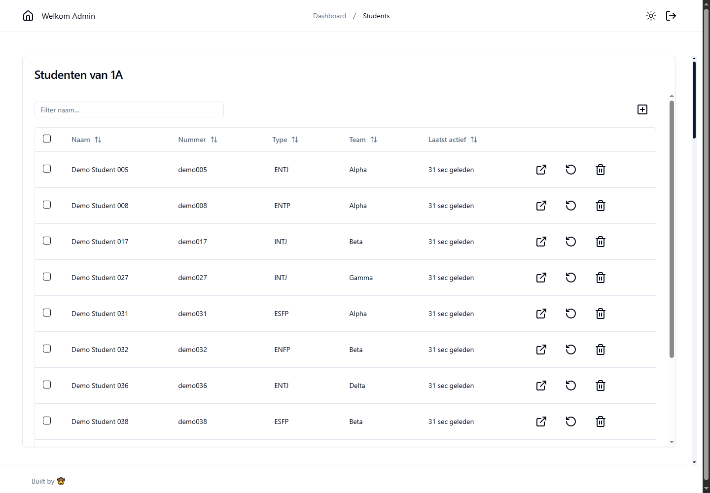
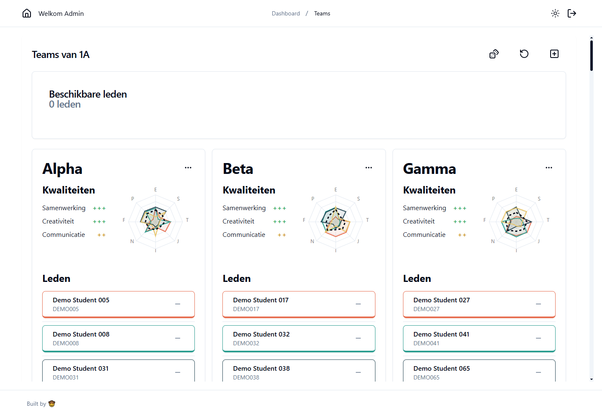

# Actiontypes

A student questionnaire and teacher dashboard I built on my own, with a prototype for grouping students by personality type.

- **Role:** Solo developer
- **Period:** 2024–2026
- **Stack:** Astro, React, TypeScript, Bun, Astro DB, SQLite, Tailwind CSS, shadcn/ui, Lucia

## What I wanted to build

For my WP-3 retake, students needed to answer pairs of statements and get a four-letter personality type. Teachers needed to inspect the answers and manage student records.

The assignment called for a REST API and SQL storage. Students needed to resume an unfinished questionnaire without completing it twice, and teacher pages needed authentication.

The dashboard above is running locally with fictional demo students.

## How I built it

I started with Flask and SQLite, alongside a React frontend that later became a Next.js app. I wanted to practice frameworks after doing a lot of Flask work in the previous project. I thought my teacher might appreciate the extra effort, even where my choices departed from the brief.

I later rebuilt it with Astro and TypeScript, React components and Astro DB. Lucia handles authentication and sessions. Teachers can manage student records, inspect answers, reset questionnaires and manually assign students to existing teams.

The team-grouping prototype keeps students within their class and maps their questionnaire types to four roles: direction, innovation, implementation and people. It first tries to spread those roles across teams, then fills the smallest teams, preferring missing roles or a better balance across the four letter pairs. The seed script uses a maximum of five members per team.

The team radar values and quality labels are illustrative. They are not measurements of student or team performance.

## Result and next questions

I passed the retake with distinction and kept developing the app. The current version has student management, answer inspection, questionnaire resets and team views.

The grouping function currently runs when generating demo data. The dashboard's automatic-assignment controls are not connected yet.

Making a team look balanced in code doesn't tell me whether its members work better together. My idea was to compare mixed types, opposites and similar personalities, then follow individual and group performance over several years of classes. That comparison and outcome tracking are still proposed work.

[Back to the project list](../../README.md)
