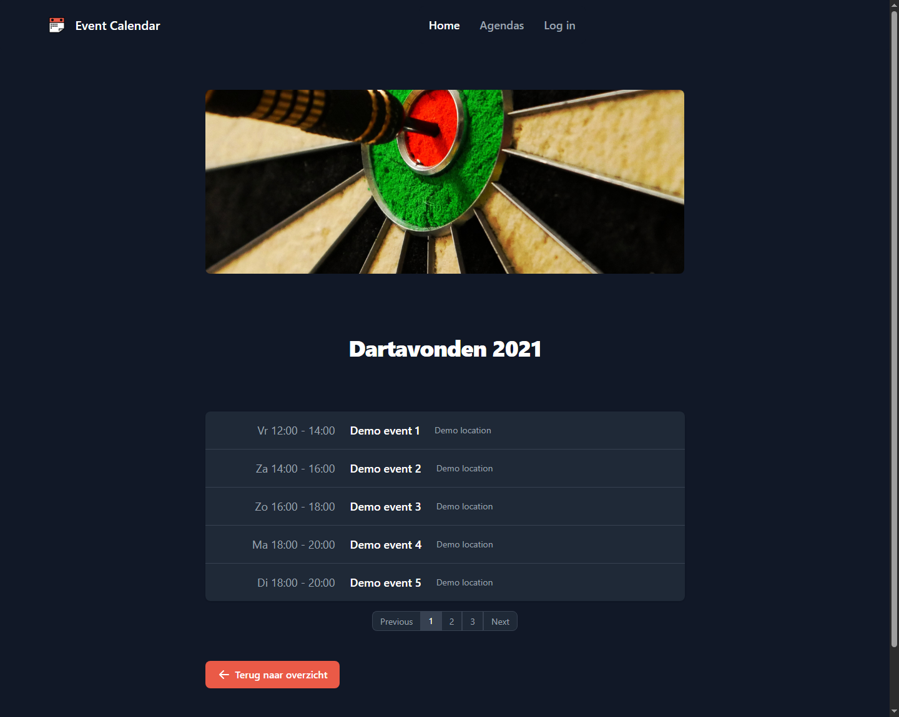
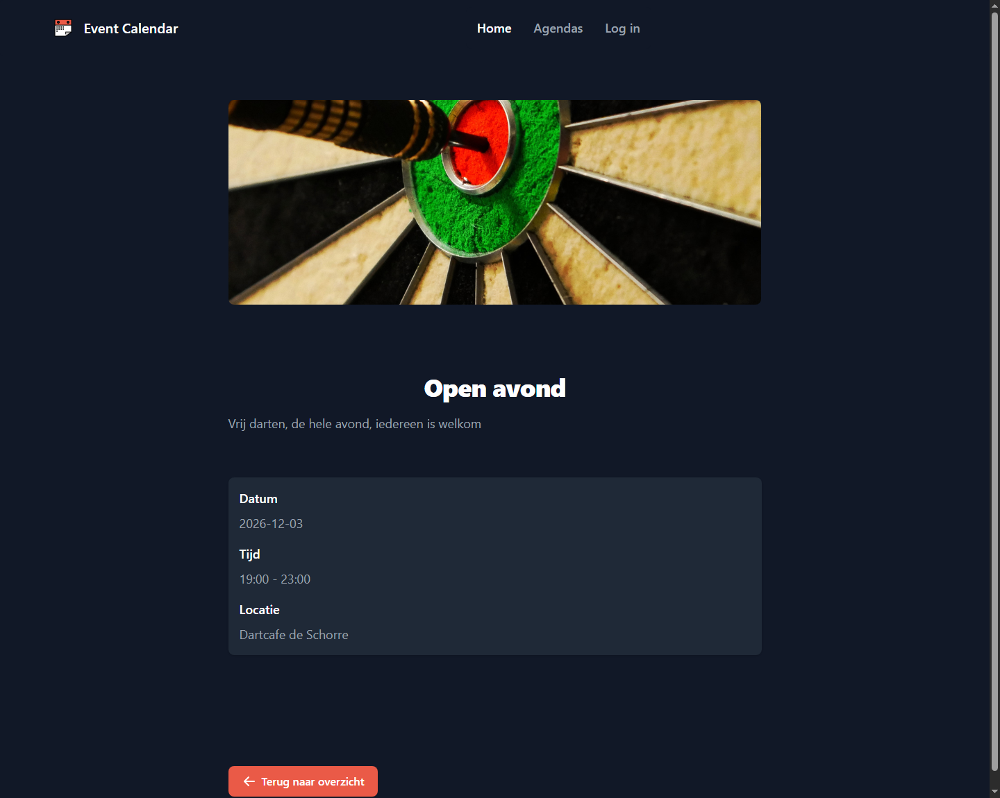
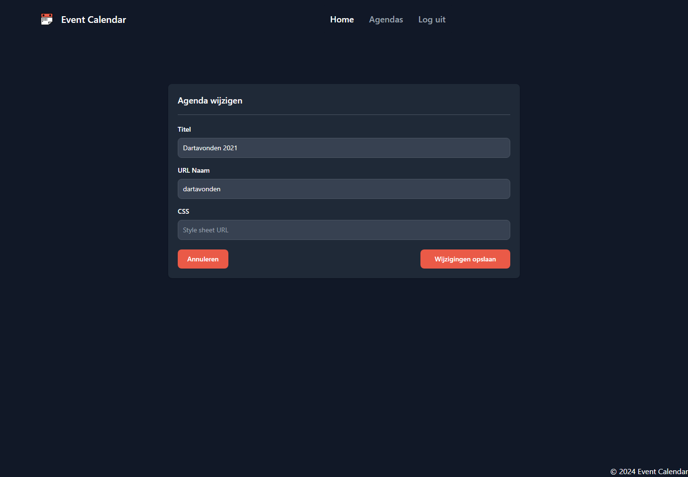

# Event Calendar

A Flask event calendar I built on my own for a retake, with public event pages, login and an editor for agendas.

- **Role:** Solo developer
- **Period:** March 2024
- **Stack:** Python, Flask, Flask-Login, Jinja2, SQLite, JavaScript, jQuery, Tailwind CSS, Flowbite

## What I wanted to build

The assignment was to make an event calendar with public listings and event details, plus management pages for logged-in users.

It required Flask, Jinja templates and handwritten SQL. Database operations belonged in the model layer, routes handled requests, and HTML stayed in templates.

The public agenda above is running locally with the project's demo events.

## How I built it

I built models for users, agendas and events, with shared operations for creating, reading, updating and deleting records. Flask blueprints separate the public pages, login and JSON endpoints.

The agenda overview loads cards and event previews through jQuery requests. Inside an agenda, the server selects five events at a time, ordered by date and start time, using SQL LIMIT and OFFSET. An event's detail page then fetches its record from the API.

I used Flask-Login for the session and protected the pages for creating, editing and deleting agendas. The forms send JSON requests to the API. Deleting an agenda asks the user to type its current title before submitting.

The interface started with Bootstrap and later switched to Tailwind and Flowbite, adding a Node build step for the CSS.

## Result and reflection

I passed the retake with public agenda and event pages, login, and working forms to create, edit and delete agendas. Event creation and editing have API endpoints, but their management screens and the administrator's user-management interface remained unfinished.

Working alone made it easier to move quickly, but also easier to keep trying another library or improving another detail. I had to be more deliberate about what was required, what I wanted to experiment with and when to stop.

All screenshots use a fresh local demo database. The event-detail date was generated relative to the date of that local setup.

[Back to the project list](../../README.md)
