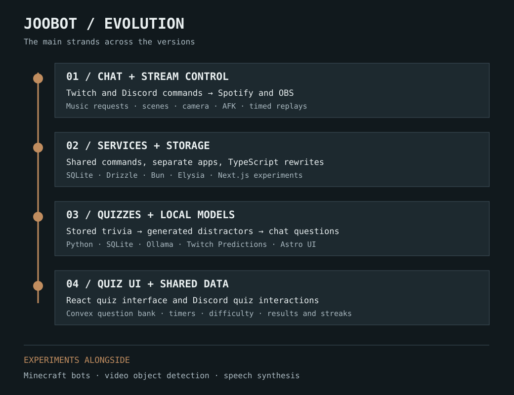
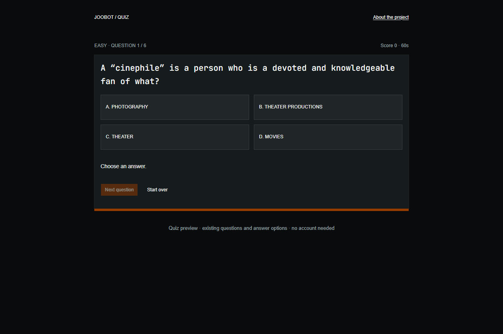
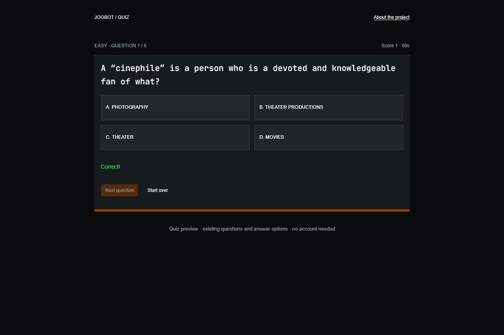

# JooBot

A bot project that grew from chat-controlled music and stream tools into
interactive quizzes. It spans several JavaScript, TypeScript and Python
iterations, with different features and structures along the way.

- **Role:** Developer
- **Status:** Ongoing project with earlier prototypes and rewrites
- **Try:** [Quiz preview](https://demo.jordy.zip/sd/joobot-quiz/)

## Chat commands and stream control

The early JavaScript bot connected Twitch and Discord messages to commands for
Spotify and OBS. I could request music, control playback and switch stream
scenes through chat.

The replay command is a good example of how those pieces worked together. It
reads the current OBS scene, triggers the replay-buffer hotkey, switches to the
replay scene and returns to the original scene after the requested duration.
The duration is bounded, and the command checks whether a replay or AFK scene
is already active.

## Changing the structure

The later JavaScript versions split the bot into separate apps and shared
command modules. Twitch, Discord, Spotify and the HTTP server no longer had to
live in the same entrypoint. Some older commands remained alongside the newer
structure while I worked through the rewrite.

The TypeScript versions explored typed command arguments, a different Spotify
SDK and newer OBS calls. I also experimented with storing commands in SQLite.
One Bun monorepo brought together Drizzle, Elysia and Next.js endpoints for
reading command data. That work was a backend and project-structure experiment;
the Next.js interface was still mostly its starter page.

These weren't clean releases with every earlier feature carried forward.
Different copies preserve different stages, and several of the rewrites remain
partial.

## Moving towards quizzes

The Python versions put more attention on a question bank. I imported trivia
into SQLite, with fields for the correct answer, three distractors, difficulty
and category. Ollama supplied categories and plausible wrong answers where
they were missing, so those could be kept with the question for reuse.

The Twitch quiz handler used Predictions for participation. An Astro version
explored displaying questions and answers as cards on screen. That UI experiment
and the chat bot were separate pieces of the work.

## React, Convex and Discord

The more recent quiz work uses a React interface and a Convex question bank,
with difficulty selection, a timer and shuffled answers. A Discord quiz command
uses buttons for answers, records results and exposes a leaderboard with
accuracy and streaks.

The browser UI and Discord bot share question data, but have different
interaction flows. Discord results are stored; the public quiz preview keeps
only temporary progress.

The preview uses ten prepared questions from an existing Convex export. It
reuses the current quiz styling, answer shuffle and timer, with a small
browser-only adapter. It doesn't need chat accounts or a running local model.

## Experiments alongside it

The project folders also contain Minecraft bot/pathfinding work, video object
detection and speech-synthesis experiments. Those are side branches of the
project, rather than a claim that the latest quiz app does all of them.

For now, this page brings the main iterations together. The next useful step is
to document which versions I used day to day and which were short experiments.

[Back to the project list](../../README.md)
