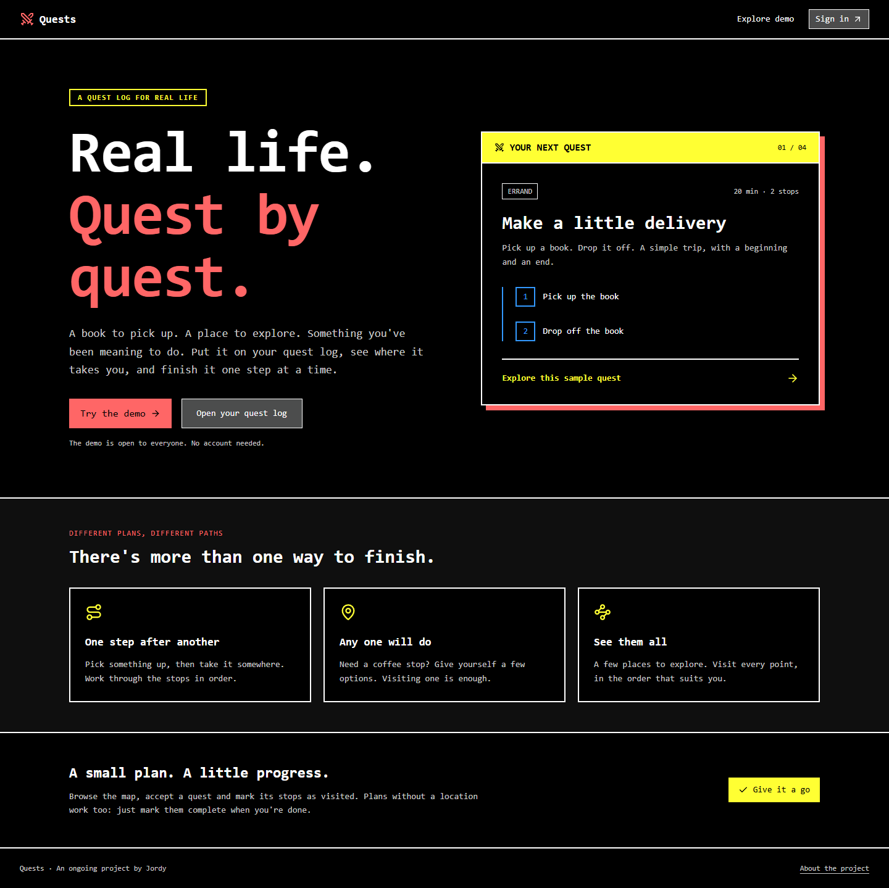
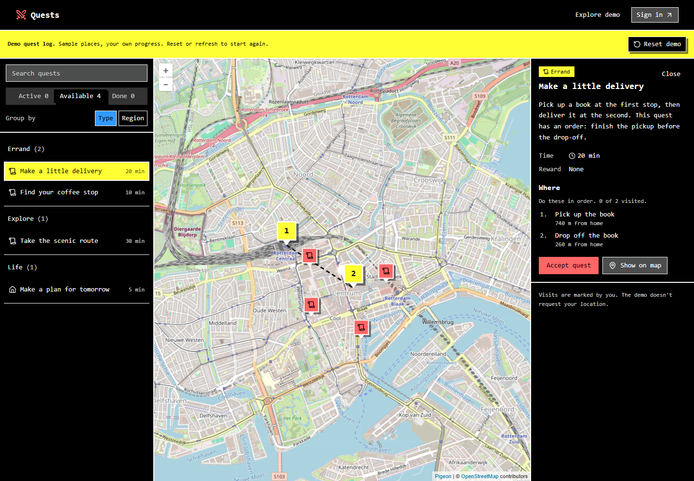
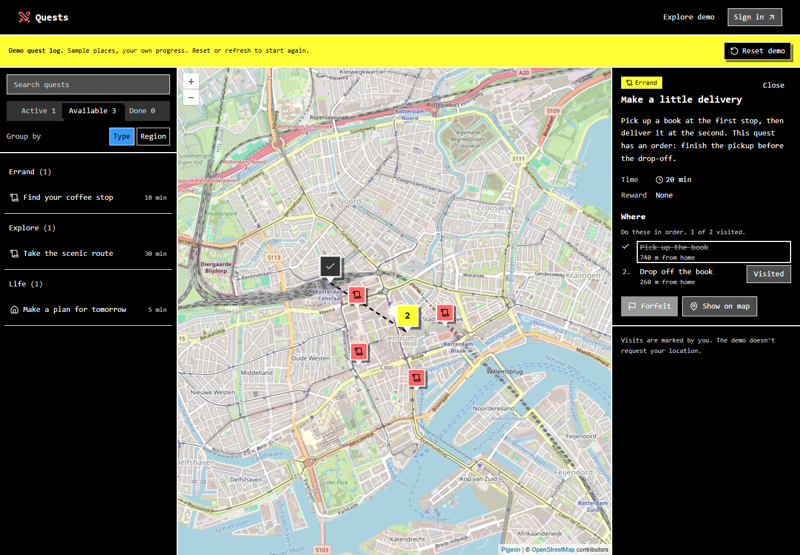

# Quests

A quest log for real life. I'm building a map-based app for everyday plans,
with places to visit and progress to work through one step at a time.

- **Project:** Ongoing personal project
- **Role:** Developer
- **Stack:** React Router, React, TypeScript, Convex, Pigeon Maps, Tailwind CSS
- **Try it:** [Quests](https://quests.jordy.zip/) · [Interactive demo](https://quests.jordy.zip/demo)

## The idea

Some plans have an order: pick up a book, then drop it off. Others have options:
any one coffee stop will do. And sometimes I want to visit several places
without deciding the order in advance.

Quests puts those plans on a map alongside a quest list. I can accept a quest,
see its stops and mark my progress. Tasks without a location can be completed
manually.

## How it works

The waypoint rules support three modes:

- **Sequence:** complete each stop in order.
- **Any:** visiting one of the possible stops completes the quest.
- **All:** visit every stop, in any order.

I keep that logic in a shared TypeScript module so the interface and Convex
backend use the same rules. Waypoints have stable IDs, and progress records
which ones have been visited. The server also checks who owns a quest and who
can see it. Tests cover waypoint order, completion, duplicate visits and access
between users.

The map, list and detail panel share the selected quest. Selecting a quest
focuses the map on its stops, and the interface shows which stop can be visited
next.

## Making it easier to try

The app originally opened on a sign-in screen. I added a landing page to explain
the idea first, plus a public demo using the app's map, list, detail components
and waypoint rules. It has four sample quests and temporary progress that can
be reset. No account is needed to explore it.

The account-based app remains separate and stores its data in Convex. The demo
uses sample locations and doesn't request the visitor's location.

## What's next

This is still a work in progress. Visits are self-reported. Friend sharing,
device-private quests and location verification are ideas for further work,
rather than features I'm presenting as finished.

[Back to the project list](../../README.md)
